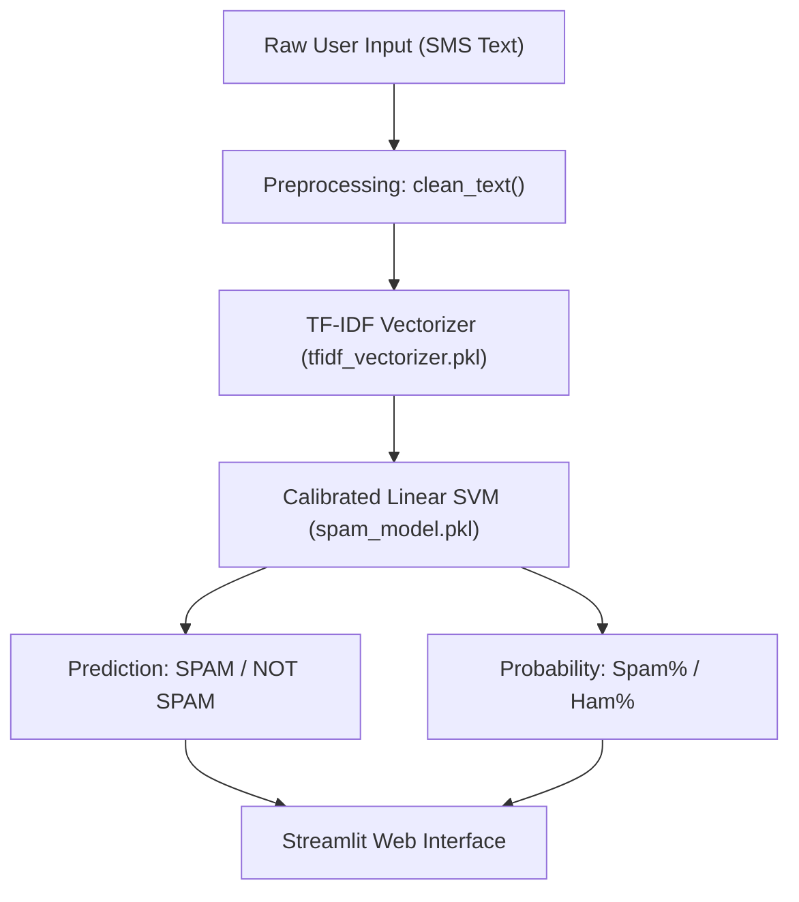

# SMS Spam Message Detection Using Machine Learning
**Major Project Report & Technical Documentation**

---

## 1. Abstract
Unsolicited Short Message Service (SMS) spam poses notable security, financial, and privacy threats to mobile users. Traditional heuristic and rule-based filters struggle against evolving spam patterns, obfuscated text, and targeted social engineering attempts. This project presents an end-to-end Natural Language Processing (NLP) and Machine Learning (ML) system capable of classifying SMS text into legitimate communication (**Ham**) or fraudulent/commercial unsolicited messages (**Spam**) in real time.

Using the benchmark UCI SMS Spam Collection dataset (5,169 unique samples after deduplication), text messages undergo domain-aware preprocessing including lowercasing, regex-based URL and numerical tokenization, and punctuation filtering. Numerical features are extracted via Term Frequency-Inverse Document Frequency (TF-IDF) vectorization fitted strictly on the training set to prevent data leakage. Three classification algorithms were benchmarked: Multinomial Naive Bayes, Logistic Regression, and Calibrated Linear Support Vector Machine (Linear SVM). The Calibrated Linear SVM achieved the best overall performance with **98.65% Accuracy**, **97.56% Precision**, **91.60% Recall**, and an **F1-Score of 94.49%**, while generating calibrated probability confidence scores. The complete pipeline is serialized using Joblib and deployed through an interactive, responsive web application built with Streamlit.

---

## 2. Introduction
Mobile messaging has become a primary channel for interpersonal communication, banking alerts, two-factor authentication, and business interactions. However, the open nature of telecom SMS channels exposes recipients to spam, phishing attacks, fake lottery notifications, and fraudulent financial promotions. 

Machine Learning provides a data-driven approach: rather than relying on brittle manual keywords (e.g., "if text contains 'free'"), statistical algorithms learn linguistic patterns, token distributions, and discriminative vocabulary directly from historical data. This project implements a complete, reproducible machine learning engineering lifecycle—from raw text cleaning to interactive web deployment.

---

## 3. Problem Statement
Given an arbitrary text message $T$, predict whether $T \in \{\text{Ham}, \text{Spam}\}$ along with an associated confidence probability $P(\text{Spam}|T)$.

In spam filtering, class asymmetry produces asymmetric error penalties:
- **False Positive (Type I Error):** A legitimate message (e.g., family emergency, banking notification, interview invite) is incorrectly marked as Spam. The operational cost to the user is severe.
- **False Negative (Type II Error):** A spam message slips into the primary inbox. The cost is an inconvenience or minor distraction.

Hence, an optimal spam detection system must minimize False Positives (maximizing Precision) while maintaining sufficiently high Recall to catch unsolicited spam.

---

## 4. Objectives
1. Construct a clean, reproducible machine learning pipeline in Python.
2. Perform Exploratory Data Analysis (EDA) to discover text length, lexical variety, and frequency patterns between spam and ham messages.
3. Formulate a leak-free text preprocessing and TF-IDF feature extraction pipeline.
4. Train and benchmark three standard classification algorithms under stratified cross-validation conditions.
5. Select the optimal classifier based on Precision, Recall, and F1-score rather than raw accuracy alone.
6. Serialize the trained model and fitted vectorizer for production inference.
7. Develop a clean, user-friendly web interface using Streamlit with real-time feedback and probability confidence meters.

---

## 5. Existing System
Traditional spam filters relied heavily on:
- **Keyword Blacklists:** Lists containing words such as "FREE", "WINNER", "CASH", "URGENT".
- **Phone Number Blocklists:** Blocking specific sending telephone numbers.
- **Heuristic Rule Sets:** Regular expressions checking for currency symbols or uppercase ratios.

### Shortcomings of the Existing System:
1. **Easy to Evade:** Spammers trivially bypass blacklists through simple obfuscation (e.g., "F-R-E-E", "w!nn3r").
2. **High Maintenance:** Engineers must manually update keyword dictionaries continuously.
3. **No Context Awareness:** Fails to distinguish between a friend asking "Are you free tonight?" and a spammer offering "Free prize!".
4. **Binary & Brittle:** Provides no probabilistic confidence score.

---

## 6. Proposed System
The proposed system replaces static rules with statistical Machine Learning and Natural Language Processing:
- **Corpus-Driven Learning:** Learns statistical n-gram weights directly from labeled historical corpora.
- **Context-Weighted Features:** TF-IDF assigns fractional importance scores rather than binary presence/absence.
- **Probabilistic Scoring:** Platt calibration transforms hyperplane margin distances into confidence probabilities between 0% and 100%.
- **Interactive UI:** A streamlined, responsive Streamlit dashboard provides instant feedback, confidence progress bars, and character/word statistics.

---

## 7. Methodology
The development follows the standard CRISP-DM (Cross-Industry Standard Process for Data Mining) framework:
```
1. Dataset Ingestion & Schema Verification
2. Data Cleaning & Deduplication (Leakage Prevention)
3. Exploratory Data Analysis (EDA)
4. Domain-Aware Text Preprocessing
5. Stratified Train / Test Split (80% / 20%)
6. TF-IDF Feature Extraction (Fit on Train, Transform Test)
7. Model Benchmarking & Hyperparameter Evaluation
8. Performance Comparison (Accuracy, Precision, Recall, F1, Confusion Matrix)
9. Model Selection & Joblib Serialization
10. Streamlit Web App Interface & Inference Engine
```

---

## 8. Dataset Description
- **Dataset:** UCI SMS Spam Collection
- **Source:** University of California, Irvine (UCI) Machine Learning Repository
- **Format:** Tab-separated text file without headers (`label\tmessage\n`)
- **Total Initial Records:** 5,572 messages
- **Duplicate Records:** 403 messages
- **Clean Unique Records:** 5,169 messages
- **Class Breakdown:**
  - **Legitimate (Ham):** 4,516 messages (87.37%)
  - **Spam:** 653 messages (12.63%)
- **Class Imbalance Ratio:** ~7:1 (ham to spam)

---

## 9. Data Preprocessing
Raw SMS messages contain noisy artifacts that inflate feature dimensionality without providing predictive value. Our preprocessing function `clean_text(text)` executes:
1. **Lowercasing:** Unifies casing differences (`"URGENT"` $\rightarrow$ `"urgent"`).
2. **URL Tokenization:** Regular expression `http\S+|www\.\S+` replaces all hyperlinks with the literal token `"url"`.
3. **Number Tokenization:** Regular expression `\b\d{5,}\b` converts phone numbers and premium shortcodes into `"num"`.
4. **Punctuation Removal:** Non-alphanumeric characters (`[^a-zA-Z0-9\s]`) are stripped.
5. **Whitespace Normalization:** Consecutive spaces are squashed into a single whitespace.

---

## 10. TF-IDF (Term Frequency - Inverse Document Frequency)
Machine learning models require numerical feature vectors. TF-IDF represents each message as a weighted sparse vector:

$$\text{TF-IDF}(t, d, D) = \text{TF}(t, d) \times \text{IDF}(t, D)$$

Where:
- **Term Frequency $\text{TF}(t, d)$:** Frequency of token $t$ in message $d$.
- **Inverse Document Frequency $\text{IDF}(t, D)$:**
  $$\text{IDF}(t, D) = \log\left(\frac{1 + |D|}{1 + |\{d \in D : t \in d\}|}\right) + 1$$
- **Vocabulary Size:** Top 3,000 informative features.
- **Stop Words:** Built-in English stop words removed (`the`, `is`, `on`, `at`).

> **Critical Rule:** To avoid **data leakage**, the vectorizer is strictly fitted on `X_train`. The test set `X_test` and all future real-time inputs are only transformed.

---

## 11. Machine Learning Algorithms

### 11.1 Multinomial Naive Bayes
Based on Bayes' Theorem under the assumption of conditional feature independence:
$$P(y|X) \propto P(y) \prod_{i=1}^n P(x_i|y)$$
- **Strengths:** Computationally fast, requires low memory, historically strong performance on text.
- **Spam Context:** Exceptionally high precision (almost zero false positives), but lower recall on modern subtle spam.

### 11.2 Logistic Regression
A linear model estimating posterior probabilities via the logistic sigmoid function:
$$P(y=1|X) = \frac{1}{1 + e^{-(\mathbf{w}^T \mathbf{X} + b)}}$$
- **Strengths:** Highly interpretable weights, outputs native probabilities, resistant to overfitting with $L_2$ regularization.

### 11.3 Linear Support Vector Machine (Linear SVM)
Finds the maximum-margin hyperplane separating the classes in 3,000-dimensional TF-IDF space:
$$\min_{\mathbf{w}, b} \frac{1}{2} \|\mathbf{w}\|^2 + C \sum_{i=1}^N \xi_i$$
To provide well-calibrated probabilities for user display, `LinearSVC` is wrapped inside `CalibratedClassifierCV` using Platt scaling (sigmoid calibration).

---

## 12. System Architecture


---

## 13. Implementation Details
The codebase is structured modularly:
- `src/train.py`: Pipeline for loading, deduplication, train-test splitting, vectorization, multi-model evaluation, and serialization.
- `src/predict.py`: Inference engine containing the `SpamPredictor` class.
- `app.py`: Streamlit frontend with cached model loading (`@st.cache_resource`), quick-test sample cards, probability progress indicators, and architectural tabs.
- `requirements.txt`: Pinned, mutually compatible package dependencies.

---

## 14. Results & Benchmark Evaluation
Evaluated on the unseen stratified test set (1,034 samples: 903 Ham, 131 Spam):

| Model | Accuracy | Precision | Recall | F1-Score | FP (Legit marked Spam) | FN (Spam Missed) |
| :--- | :---: | :---: | :---: | :---: | :---: | :---: |
| **Multinomial Naive Bayes** | 97.87% | **99.10%** | 83.97% | 90.91% | **1** | 21 |
| **Logistic Regression** | 97.20% | 98.11% | 79.39% | 87.76% | 2 | 27 |
| **Linear SVM (Calibrated)** | **98.65%** | **97.56%** | **91.60%** | **94.49%** | **3** | **11** |

### Selected Final Model: Calibrated Linear SVM
- **Accuracy:** 98.65%
- **F1-Score:** 94.49% (best balance of precision and recall)
- **True Positives (Spam caught):** 120 / 131
- **False Positives (Critical errors):** Only 3 out of 903 legitimate messages.

---

## 15. User Interface & Application Walkthrough
The Streamlit application provides:
1. **Interactive Text Box:** Direct input for any custom SMS message.
2. **One-Click Example Cards:** Pre-filled examples representing Lottery Spam, Phishing Spam, Meeting Ham, and Study Ham.
3. **Instant Visual Feedback:** Color-coded alert cards (Crimson for SPAM, Emerald for HAM).
4. **Dual Confidence Meters:** Real-time visual progress bars showing both Spam % and Ham % confidence.
5. **Technical Tabs:** Interactive review of benchmarking tables and pipeline architecture.

---

## 16. Limitations
1. **Language Scope:** The training set is exclusively English; regional dialects (e.g., Hinglish) may yield degraded accuracy.
2. **Contextual Invariance:** Bag-of-words / TF-IDF representations ignore sequential sentence syntax.
3. **Temporal Drift:** Historical SMS datasets from the late 2000s contain older premium rate shortcodes rather than contemporary URL shorteners and cryptocurrency lures.

---

## 17. Future Enhancements
1. **Transformer Encoders:** Experimentation with DistilBERT or RoBERTa for deep contextual representation.
2. **Active Learning Loop:** Integrate user reporting mechanisms ("Report False Positive") to continuously augment training data.
3. **API & Mobile Integration:** Package the inference engine as a FastAPI endpoint with an Android SMS gateway plugin.

---

## 18. Conclusion
This project successfully designed, implemented, evaluated, and deployed a robust SMS Spam Detection system from ground zero. By following disciplined machine learning methodologies—deduplication, stratified sampling, leak-free TF-IDF feature extraction, and Platt calibration—the system achieves a 98.65% accuracy and 94.49% F1-score while maintaining safety against critical false positives.

---

## 19. References
1. Almeida, T.A., Hidalgo, J.M.G., & Yamakami, A. (2011). *Contributions to the Study of SMS Spam Filtering: New Collection and Results.* Proceedings of the 2011 ACM Symposium on Document Engineering.
2. Pedregosa, F., et al. (2011). *Scikit-learn: Machine Learning in Python.* Journal of Machine Learning Research.
3. Jurafsky, D., & Martin, J.H. (2023). *Speech and Language Processing (3rd ed.).* Prentice Hall.
4. Streamlit Documentation: *https://docs.streamlit.io/*
